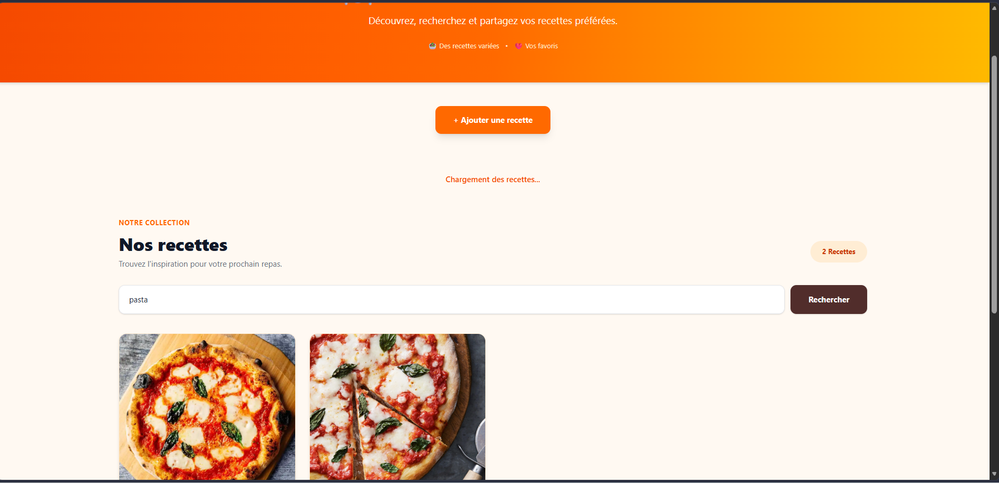
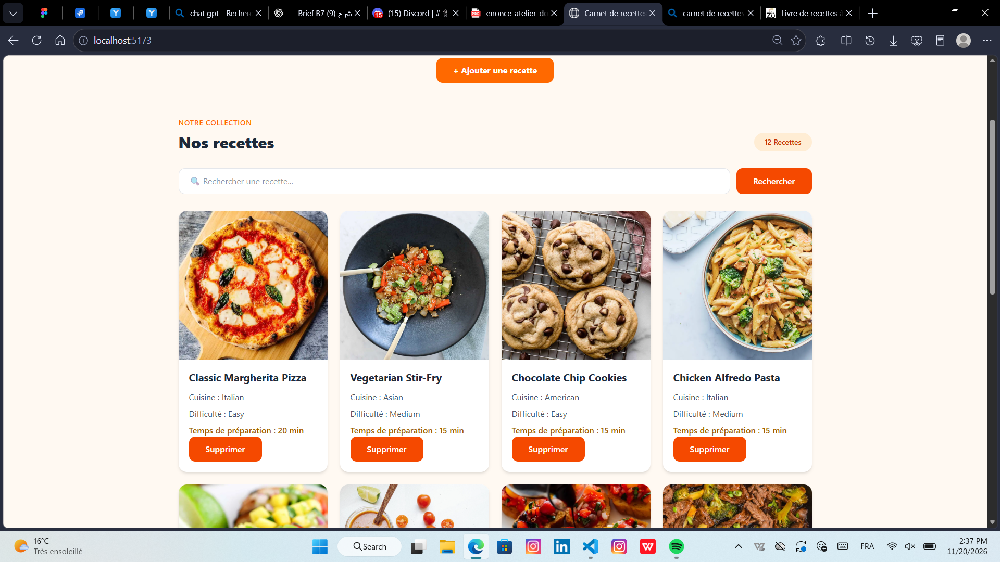
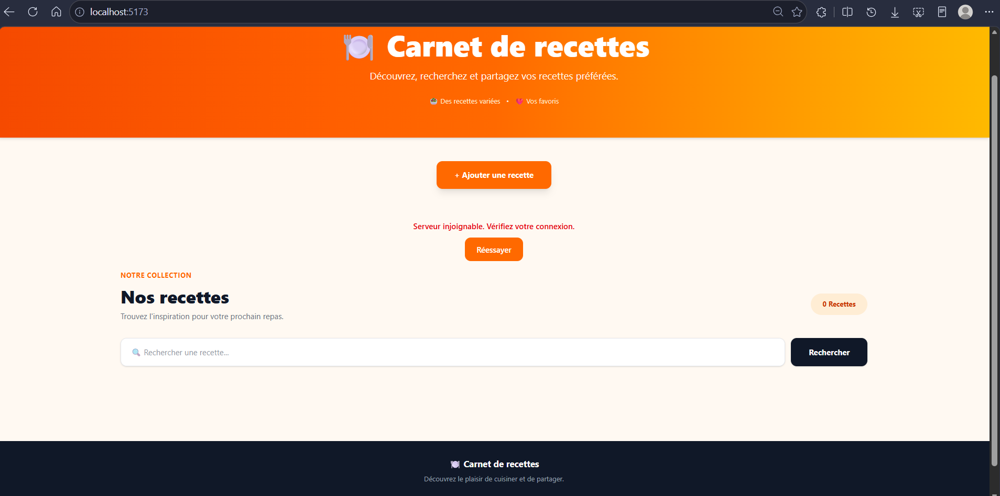
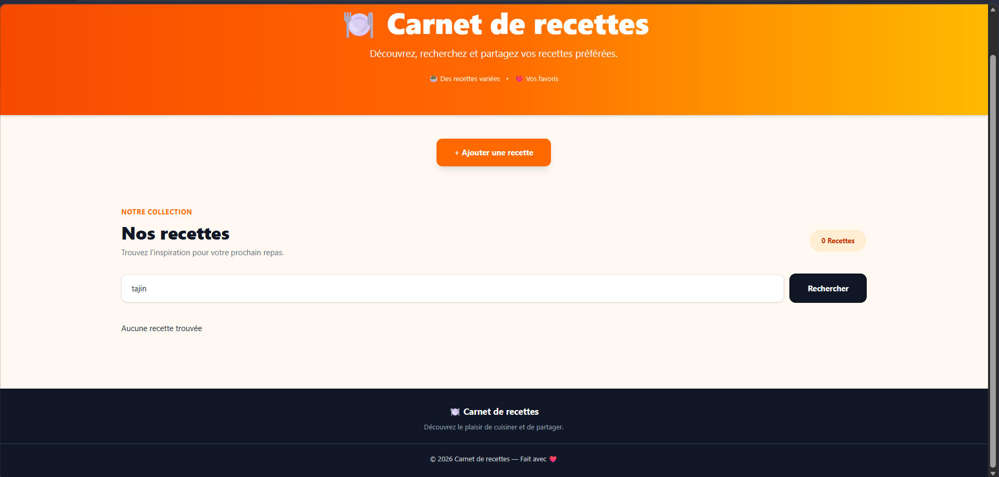

# 🍽️ Carnet de recettes

## 📖 Présentation du projet

Carnet de recettes est une application web qui permet aux utilisateurs de découvrir, rechercher, ajouter et supprimer des recettes.

L'application utilise une API externe pour récupérer les recettes et Axios pour communiquer avec le serveur.

## 🎯 Objectifs

- Afficher une liste de recettes.
- Rechercher une recette par son nom.
- Ajouter une nouvelle recette.
- Supprimer une recette.
- Gérer les états de chargement et les erreurs.
- Créer une interface simple et responsive.

## 📁 Structure des fichiers

```text
Carnet-de-recettes/
│
├── index.html
├── css/
│   └── style.css
├── js/
│   ├── main.js
│   ├── api.js
│   ├── affichage.js
│   ├── form.js
│   └── validation.js
├── assets/
├── package.json
└── README.md
```

### Rôle des fichiers

- **index.html** : Structure de la page web.
- **style.css** : Styles et mise en forme de l'application.
- **main.js** : Point d'entrée, gestion de l'affichage des recettes et de la recherche.
- **api.js** : Communication avec l'API grâce à Axios.
- **affichage.js** : Création et affichage des cartes de recettes.
- **form.js** : Gestion du formulaire d'ajout et de la suppression des recettes.
- **validation.js** : Vérification des données saisies dans le formulaire.
- **assets/** : Contient les ressources du projet.

## 🛠️ Technologies utilisées

- **HTML5** : Structure de l'application.
- **Tailwind CSS** : Mise en forme et design responsive.
- **JavaScript (ES6+)** : Gestion des interactions et de la logique.
- **Axios** : Communication avec l'API.
- **Vite** : Outil de développement et de lancement du projet.
- **DummyJSON API** : Fournit les données des recettes.
- **Git et GitHub** : Gestion des versions et hébergement du code.

## 🚀 Installation et lancement du projet

### 1. Cloner le projet

```bash
git clone https://github.com/benddri/Carnet-de-recettes
```

### 2. Accéder au dossier

```bash
cd Carnet-de-recettes
```

### 3. Installer les dépendances

```bash
npm install
```

### 4. Lancer le serveur de développement

```bash
npm run dev
```

Ouvrir ensuite l'adresse locale affichée dans le terminal par Vite.

## 🌐 Documentation de l'API

L'application utilise l'API DummyJSON : `https://dummyjson.com`

| Fonctionnalité | Méthode HTTP | URL | Données envoyées | Réponse |
|---|---|---|---|---|
| Afficher les recettes | GET | `/recipes?limit=12` | Aucune | Liste des recettes |
| Rechercher une recette | GET | `/recipes/search?q={query}` | Mot-clé de recherche | Recettes correspondantes |
| Ajouter une recette | POST | `/recipes/add` | Nom, cuisine, difficulté, temps de préparation | Recette créée |
| Supprimer une recette | DELETE | `/recipes/{id}` | Identifiant de la recette dans l'URL | Confirmation de suppression |

### ⚠️ Limitation de l'API

DummyJSON est une API de démonstration. Les opérations d'ajout et de suppression sont simulées : les modifications ne sont pas conservées définitivement sur le serveur.


## 🧪 Scénarios de tests manuels

| Test | Action | Résultat attendu |
|---|---|---|
| Chargement | Ouvrir l'application | Affichage du chargement puis des recettes |
| Liste des recettes | Charger la page | Affichage des recettes |
| Recherche vide | Rechercher un mot-clé inexistant | Message « Aucune recette trouvée » |
| Ajout invalide | Envoyer un formulaire vide | Affichage des messages de validation |
| Ajout valide | Remplir correctement le formulaire | Message de confirmation |
| Suppression | Cliquer sur le bouton supprimer | Suppression de la recette de l'affichage |
| Erreur 404 | Simuler une erreur 404 | Affichage d'un message d'erreur |
| Erreur 500 | Simuler une erreur 500 | Affichage d'une erreur serveur |
| Hors connexion | Couper la connexion Internet | Affichage d'un message de connexion impossible |


## 📸 Captures d'écran

### 1. Chargement


### 2. Liste des recettes


### 3. Message d'erreur


### 4. Aucun résultat


